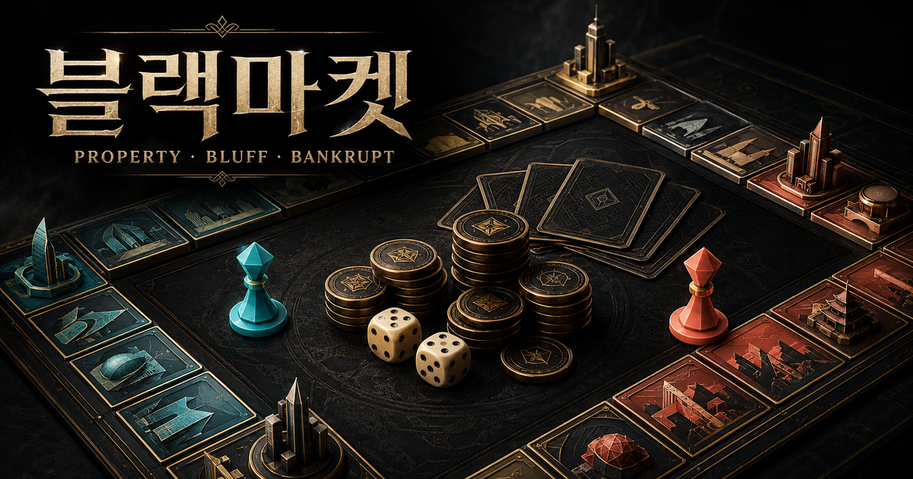

# 블랙마켓 (BLACK MARKET)

> 주사위, 부동산 투자, 포커 블러핑이 결합된 온라인 2인 경제 전략 보드게임

[🎮 블랙마켓 플레이하기](https://black-market-pvp.balmy-rhea-9704.chatgpt.site)



## 게임 소개

플레이어는 네온빛 암시장의 구역을 인수하고 건물을 확장해 상대에게 통행료를 받습니다.  
15라운드가 끝났을 때 더 높은 순자산을 보유하거나, 그전에 상대를 파산시키면 승리합니다.

단순히 주사위 운에만 의존하지 않고 현금 보유, 구역 투자, 건물 확장, 포커 베팅과 폴드 판단을 함께 사용해야 합니다.

## 주요 기능

- 인공지능 대전 및 방 코드 방식의 온라인 2인 대전
- 플레이어 닉네임과 6종 말 스킨 선택
- 두 개의 주사위와 한 칸씩 이동하는 애니메이션
- 24칸 암시장 보드와 가격이 다른 12개 구역
- 구역 인수, 건물 확장, 통행료와 순자산 시스템
- 후반으로 갈수록 통행료가 최대 2배가 되는 시장 위험도
- $50·$100·$200 중 판돈을 선택하는 한 장 포커 블러핑
- 암거래 사건, 세관 조사, 검문소와 휴식 칸
- 게임 중 언제든 확인할 수 있는 한국어 설명서
- 종료 후 파산·순자산·현금·보유 구역을 비교하는 승리 이유 분석

## 기본 규칙

1. 양쪽 플레이어는 $1,000를 가지고 시작합니다.
2. 차례가 되면 주사위 두 개를 굴리고 나온 수만큼 이동합니다.
3. 주인이 없는 구역은 구매할 수 있습니다.
4. 자신의 구역에 다시 도착하면 건물을 확장할 수 있습니다.
5. 상대 구역에 도착하면 건물 단계와 시장 위험도에 따른 통행료를 냅니다.
6. 더블 주사위가 나오면 추가 차례를 얻습니다.
7. 상대의 현금이 $0이 되거나 15라운드 종료 후 순자산이 더 높으면 승리합니다.

## 온라인 대전 방법

1. 한 명이 **온라인 2인 대전 → 방 만들기**를 선택합니다.
2. 생성된 6자리 방 코드를 친구에게 보냅니다.
3. 친구는 자기 컴퓨터에서 게임에 접속해 **방 코드로 참가**를 선택합니다.
4. 같은 코드를 입력하면 게임이 시작됩니다.

## 조작 방법

- 마우스: 메뉴와 게임 행동 선택
- 스페이스바: 주사위 굴리기
- 보드 칸 클릭: 해당 칸의 규칙과 가격 확인

## 로컬 실행

### Windows

1. 저장소를 다운로드하고 압축을 풉니다.
2. Node.js 22.13 이상을 설치합니다.
3. `START_LOCAL_WINDOWS.bat`을 실행합니다.

### 터미널

```bash
npm install
npm run dev
```

## 사용 기술

- React
- TypeScript
- Next.js / Vinext
- CSS
- Cloudflare D1
- Drizzle ORM

## 제작 과정과 AI 활용

게임의 방향, 규칙 선택, 밸런스 수정, 화면 개선 요구와 반복 테스트는 프로젝트 제작자가 진행했습니다.  
생성형 AI는 코드 구현, 오류 수정, 디자인 시안 제작을 돕는 개발 도구로 활용했습니다.

---

현재 버전은 공개 테스트용 프로토타입이며 그래픽, 연출, 온라인 안정성과 반복 콘텐츠를 계속 개선하고 있습니다.
